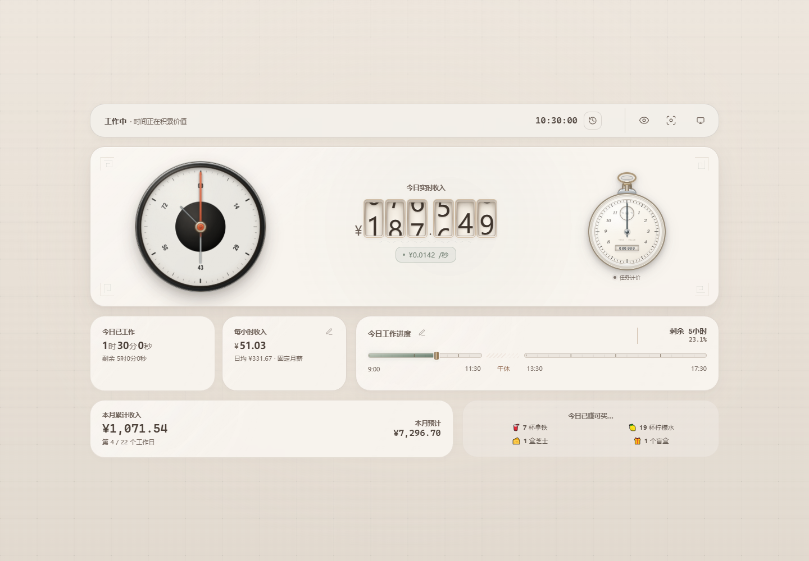
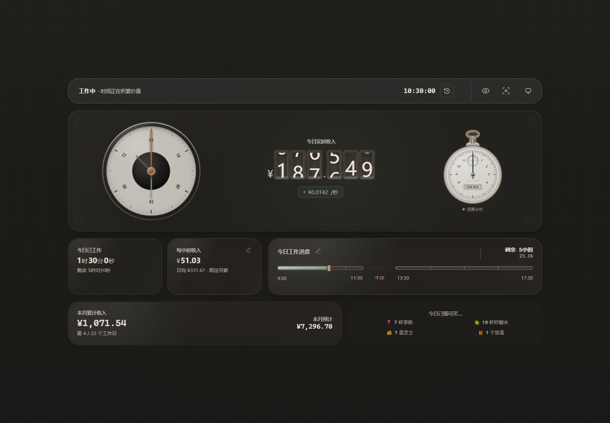

# Income-per-sed

## 产品介绍

用机械表盘与数字滚轮查看今日收入、已工作时间和剩余进度，也可以回看过去的时间点，为任务单独计时计价。

**[在线体验](https://zeuscupidcloris.github.io/Income-per-sed/)** · [查看四文件](#四文件入口) · [快速使用](#快速使用)

单文件网页，无需安装网页运行依赖；Push 支持离线打开。支持浅色、深色主题，并配有 Scriptable iPhone、iPad 小组件。下载与使用范围以许可证为准。

查看深色桌面界面

查看手机版界面

**使用边界**：收入按设置的工资与日历规则计算，不代表实际到账记录。仓库公开用于作品展示与版本存档，保留全部权利；使用范围见 [LICENSE](LICENSE)。

## 四文件入口

以下是当前仓库四文件的查看入口，不代表下载或修改授权。访客请优先使用在线体验；离线评估仅下载[官方 Release 附件](https://github.com/ZeusCupidCloris/Income-per-sed/releases)，其余复制、修改与使用需取得版权所有者的事先书面授权，详见 [LICENSE](LICENSE)。

| 入口 | 用途 |
| --- | --- |
| **[Push · 发布网页](Income-per-sed-Push.html)** | 查看当前网页文件；获准取得的 HTML 可离线打开 |
| [Widget · 手机和平板小组件](IncomeWidget.js) | 在 Scriptable 中运行，配置方式见手册 |
| [使用手册 · Word](docs/Income-per-sed（说明文档）.docx) | 快速上手、实际操作、设计细节与常见问题 |
| [Develop · 诊断网页](Income-per-sed-Develop.html) | 可读诊断产物，同样可独立打开；修改入口见下方维护说明 |

请使用同一交付批次，不与历史 Release 混用；需要核对文件完整性时，查看 [SHA-256 校验清单](SHA256SUMS.txt)。原文件名与下载路径保持不变。

## 快速使用

1. 打开[在线体验](https://zeuscupidcloris.github.io/Income-per-sed/)；离线个人评估请从官方 Release 下载未修改的 Push 附件并打开。历史 Release 可能不同于当前在线版本。
2. 点击“每小时收入”，设置收入方式和金额。
3. 点击“今日工作进度”，设置上午、午休和下午时间。
4. 使用顶部时间读数或快速回溯按钮回看。拖动全天拨盘调整时刻，点击中心时间可直接输入时分秒；选择日期后点击“定位日期”。播放或暂停历史时间，左侧回转图标返回实时；关闭面板不会自动退出回溯。

每次进入先保护金额并使用专注显示。需要全部卡片时，点击顶部专注图标；眼睛图标可临时查看金额，也可在提示中选择本次页面持续显示。默认工资是示例，请先换成自己的设置。

**小组件**：取得官方 Release 附件或事先书面授权后，安装 Scriptable，将 Widget 与 Push 文件放在 iCloud Drive 的 Scriptable 目录，按同批次使用手册完成配置。仓库中的[手册查看入口](docs/Income-per-sed（说明文档）.docx)用于了解功能。

**设置与日历**：网页设置保存在当前浏览器本地，清除站点数据会删除设置；小组件配置与网页设置读回方式见手册。内置年度日历每年手动替换，使用前请核对覆盖年份。

## 当前版本

| 项目 | 标识 |
| --- | --- |
| 四文件候选版本 | `2.8.0` |
| 交付编号 | `20261112.1` |
| 已上线版本 | `2.7.6` |

2.8.0 按卡片和操作区拆分维护源码，Develop 与 Push 仍各是一份可独立打开的 HTML。使用入口、计薪公式、字体和机械动效保持不变，无需为网页安装依赖。修复估算页签隐藏后日期被滚轮改写、回溯工时少一秒和趣味换算卡的宽度误判。

本分支的四文件仅提交审核，不等于已上线。见 [2.8.0 版本说明](docs/releases/v2.8.0.md)与[候选验收](docs/acceptance/fourfile-20261112.md)。线上与桌面仍以 [2.7.6 交付记录](docs/acceptance/fourfile-20261101.md)为准。

版本对应关系见[发布清单](release-manifest.json)，检查与上线记录见[当前交付](docs/README.md#当前交付)。普通更新同步仓库与 Pages；仅在确认大版本时发布 Release。

## 维护入口

以下内容供开发维护使用。首次查找文件可先看[仓库地图](Attachment/repository-map.md)，执行维护任务可从[集中入口](Attachment/README.md#从这里开始)开始。

| 要找什么 | 位置 |
| --- | --- |
| 全部文件路径和用途 | [仓库地图](Attachment/repository-map.md) |
| 三个检查入口 | [脚本索引](Attachment/scripts-index.md#三个主要入口) |
| 五类测试与覆盖边界 | [测试索引](Attachment/tests-index.md#五类覆盖矩阵) |
| 当前交付、待验收、历史证据 | [验收索引](docs/README.md) |
| 命名、日历、手册与发布规则 | [维护策略](docs/REPOSITORY_POLICY.md) |
| CI 的作用与重复检查评估 | [工作流评估](docs/maintainer/workflow-review.md) |
| 已完成卡片整理与分批记录 | [分批整理方案](docs/maintainer/card-css-plan.md) |
| 2.8.x 分组件重构目标与边界 | [组件维护计划](docs/maintainer/component-architecture-2.8.md) |
| 首批组件源码与单 HTML 生成 | [本地迁移说明](docs/maintainer/component-source-first-batch.md) |
| 已工作与月收入两张卡的修改入口 | [第二批本地迁移](docs/maintainer/readout-components-second-batch.md) |
| 每小时收入卡与编辑入口 | [第三批本地迁移](docs/maintainer/hourly-summary-third-batch.md) |
| 工作进度读数与编辑入口 | [第四批本地迁移](docs/maintainer/progress-readout-fourth-batch.md) |
| 组件联测与顶部状态读数 | [第五批本地迁移](docs/maintainer/status-readout-fifth-batch.md) |
| 工资日常流程与日期定位 | [第六批本地迁移](docs/maintainer/history-date-seek-sixth-batch.md) |
| 回溯精确时间输入 | [第七批本地迁移](docs/maintainer/history-time-input-seventh-batch.md) |
| 快速回溯按钮接线 | [第八批本地迁移](docs/maintainer/history-quick-buttons-eighth-batch.md) |
| 表盘几何与回溯联测 | [第九批本地迁移](docs/maintainer/history-dial-geometry-ninth-batch.md) |

`scripts/`、`tests/`、`config/` 和 `.github/` 服务于构建与自动检查，日常使用无需安装这些工具。历史资料保留原地址。

[自动检查](https://github.com/ZeusCupidCloris/Income-per-sed/actions) · [更新记录](CHANGELOG.md) · [安全报告](.github/SECURITY.md)

维护时编辑 [src/page.html](src/page.html) 及对应组件文件，再生成 Develop / Push，不手改生成文件；四文件的日常下载路径不变。先从[趣味换算卡入口](src/components/fun-conversions/README.md)了解首批边界。
